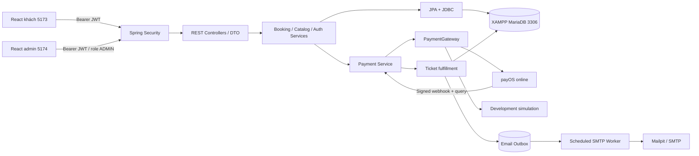

# Kiến trúc CineVerse bán vé xem phim

## Xóa dữ liệu quản trị (cập nhật 06/11/2026)

DELETE từ admin xóa vĩnh viễn bản ghi trong CSDL, không còn đổi cờ ẩn. Xóa rạp/phòng kèm phòng, ghế, suất chưa có đơn; xóa phim kèm liên kết thể loại, yêu thích, đánh giá/báo cáo, lượt xem, lịch sử xem, banner, mùa/tập và suất chưa có đơn. Xóa mùa kèm tập và lịch sử xem liên quan; xóa thể loại gỡ liên kết phim. Mỗi thao tác nằm trong một transaction, dùng whitelist bảng và ghi audit. Không thay đổi schema nên không cần migration mới.

Không cascade xóa lịch sử đặt vé hoặc thanh toán: mọi trạng thái đơn kể cả đã hủy/hết hạn đều chặn xóa rạp/phòng/suất/phim liên quan; gói đã có payment bị chặn. Quốc gia đang được phim sử dụng phải được thay ở phim trước khi xóa vì country_id bắt buộc. Giữ các FK làm lớp bảo vệ cuối và rollback nếu phát sinh liên kết đồng thời. Admin có thể sửa trạng thái Hoạt động/Nháp riêng để ngừng bán khi không xóa được. Không tự xóa các bản ghi người dùng đã có; chỉ xóa bản ghi được chọn và xác nhận trên giao diện. Tệp media dùng chung không bị xóa theo bản ghi phim.

## Ranh giới hệ thống

Modular monolith Java 21 / Spring Boot 3.5.16; hai ứng dụng React TypeScript / Vite: khách `frontend` (5173), quản trị `admin` (5174). Cùng API 8080 và MariaDB 10.4.32 của XAMPP (3306). Flyway quản lý 5 migrations / 32 bảng gồm lịch sử Flyway. MySQL 8.4 vẫn được hỗ trợ cho Compose; H2 chỉ dành cho JUnit. Java quyết định giá, quyền truy cập, giữ ghế và phát hành vé; React thể hiện trạng thái trả về từ API.

Modules hoạt động: auth/users/security, catalog/community, booking/cinema admin, payments, email, admin/audit, trailer media và shared. JPA dùng cho tài khoản, token, phim và payment order; JdbcTemplate dùng cho các truy vấn báo cáo và transaction giữ ghế cần khóa tường minh. Controller nhận DTO có validation, service giữ nghiệp vụ và transaction. Entity không được trả trực tiếp.

## Giữ ghế và giá

`BookingService.hold` khóa hàng showtime (`SELECT ... FOR UPDATE`), thu hồi reservation hết hạn, xác minh rạp/phòng/phim và giờ mở bán, khóa user để giới hạn số đơn giữ đồng thời, kiểm tra ghế thuộc đúng phòng. Chỉ nhận seat IDs; không nhận giá từ client. Giá = `showtimes.base_price` + 20.000 VND nếu ghế VIP. `booking_items` lưu snapshot nhãn/loại/giá. `seat_reservations` có unique `(showtime_id,seat_id)` làm hàng rào bảo vệ cuối ở DB.

Hold 8 phút, tối đa 8 ghế/đơn và 3 đơn đang giữ/người dùng. Scheduler 30 giây giải phóng hold hết hạn; đọc sơ đồ và đặt mới cũng dọn reservation của suất. API đóng bán trước giờ chiếu 10 phút. Giao diện đếm ngược hỗ trợ UX; backend kiểm tra thời hạn thật.

## Thanh toán và vé

Gateway hiện tại là **payOS online** (mode=payos), SDK chính thức 2.0.1. PayosPaymentGateway tạo code JS-safe lưu payos_links, dùng amount VND từ booking, kiểm signature qua SDK, bind code/amount/link và chỉ nhận checkout host pay.payos.vn. PayosReconciliationService xác minh webhook rồi query signed state, kiểm owner/admin khi đối soát, giới hạn 15 giây/đơn và scheduler 30 giây. UNDERPAID chưa phát vé; PAID phải đủ tiền. Return/cancel chỉ hiển thị và kích hoạt đối soát. Timeout create giữ pending, không tạo lại tự động. Chưa có credential nên PAYOS_ENABLED=false, readiness=false; chưa chạy giao dịch thật. payOS không có Sandbox. VNPAY/MoMo Test và simulation chỉ là adapter hồi quy dev/test; production từ chối nếu không phải payOS được cấu hình. Xem PAYOS_SETUP.md.

Mỗi booking có tối đa một payment order qua unique `payment_orders.booking_id`. Backend lấy snapshot total; create payment không phát hành vé. IPN phải qua HMAC và kiểm tra partner, request, order, amount và orderInfo. Order lock bảo vệ fulfillment; trạng thái PAID không bị callback lỗi ghi đè. Provider transaction có unique constraint.

Trong cùng transaction: ghi PAID → khóa showtime → kiểm tra booking/reservations → CONFIRMED → mỗi ghế một ticket → outbox + notification + audit. Unique `(booking_id,seat_id)` chống phát hành thêm vé khi callback lặp. QR chứa token ngẫu nhiên, không chứa mật khẩu hay email. Chỉ chủ đơn/admin đọc được mã. Admin check-in khóa vé, chấp nhận ISSUED một lần và ghi USED.

Nếu thanh toán hợp lệ đến sau khi ghế đã hết hạn/hủy: order vẫn PAID để phản ánh nhà cung cấp, booking sang PAYMENT_REVIEW, không phát vé, không chiếm ghế khách khác. Đây là ngoại lệ cần staff đối soát; chưa có tự động refund.

## Auth và bảo mật

Theo yêu cầu hiện tại, đăng ký không cần xác thực email. User mới và tài khoản cũ có verified=false đều được đăng nhập, refresh và gọi API nếu không bị khóa. Không tự đổi verified thành true vì chưa chứng minh quyền sở hữu email. Đăng ký không tạo VERIFY token/email; thông báo chào mừng được tạo ngay, không chặn đăng nhập nếu SMTP chưa cấu hình. V4 hủy các email VERIFY còn chờ. Luồng reset mật khẩu/đổi địa chỉ email vẫn xác nhận qua token email.

JWT HS256 15 phút trong bộ nhớ SPA. Refresh token ngẫu nhiên trong cookie HttpOnly/SameSite Strict, DB lưu SHA-256 hash, xoay vòng; replay thu hồi session. API mutation dùng Bearer, refresh/logout kiểm tra Origin khách/admin chính xác. Cookie cv_refresh và cv_admin_refresh tách phiên giữa hai ứng dụng vì localhost khác cổng vẫn chung cookie domain. API admin luôn kiểm ADMIN; tách bundle không phải hàng rào bảo mật. Secure cookie bật trên HTTPS. SessionGuard kiểm tra locked/sessionVersion mỗi request. BCrypt cost 12; token email/reset/đổi email một lần, có hạn và lưu hash. Rate limit auth theo IP của kết nối, không tin X-Forwarded-For tùy ý.

Uploads chỉ nhận magic bytes JPG/PNG/WebP/MP4 hoặc WEBVTT; tên UUID do server tạo, giới hạn kích thước và đường dẫn. Không fetch URL video bất kỳ nên không có proxy SSRF. Trailer dùng ticket ngắn hạn và HTTP Range; ứng dụng không cung cấp xem toàn bộ phim.

## Email và vận hành

Rate limit riêng từng endpoint/IP: đăng nhập và các thao tác auth khác tối đa 20 request/phút; refresh tối đa 120 request/phút để hỗ trợ tải lại trang được bảo vệ. Đây là giới hạn bộ nhớ của một instance, không phải giải pháp phân tán.

Outbox được insert cùng transaction nghiệp vụ. Worker claim bằng update có điều kiện, SMTP ngoài transaction đặt vé, retry exponential tối đa 5; FAILED có nút retry admin. `dedup_key` unique ngăn enqueue biên nhận trùng. SMTP là at-least-once: crash sau server nhận thư nhưng trước SENT có thể gửi lại.

Local dùng XAMPP MariaDB 3306, Mailpit loopback, Spring 8080 và hai Vite 5173/5174. Compose cung cấp MySQL/backend/hai Nginx/Mailpit, chưa được chạy trên máy không có Docker. UTC lưu trong DB; DTO Instant và serializer cho LocalDateTime đọc từ MySQL xuất ISO UTC; giao diện hiển thị Asia/Ho_Chi_Minh. Không so sánh DATETIME UTC với giờ LOCAL của DB: so sánh hold sử dụng Timestamp hiện tại bind từ Java.

## Quyết định và giới hạn

- Không microservices/Redis: giảm hạ tầng cho buổi bảo vệ.
- Khóa theo suất đủ cho đồ án; tải cao cần đo lock contention và tách gateway network I/O khỏi transaction giữ lock.
- Schema V1 giữ module ban đầu; V3 bổ sung booking và purpose order. Dữ liệu cũ được bảo toàn, không trộn doanh số membership vào thống kê vé.
- Movie metadata và artwork hư cấu; rạp demo không liên kết hệ thống thương mại.
- Production cần secret manager, HTTPS, distributed rate limit, backup/restore, quan sát vận hành, chính sách hoàn tiền và kiểm thử tải/bảo mật độc lập.

## Hai ứng dụng và dữ liệu dùng chung

Customer build frontend/dist; admin build admin/dist, dùng entry point/router riêng và tái sử dụng components/tokens trong frontend/src. Admin không có đăng ký; USER bị từ chối cả UI và API. Catalog khách refetch khi focus và khoảng 30 giây; form admin đang soạn không bị polling. JDBC MariaDB driver được chọn qua DB_DRIVER. Flyway là nguồn schema; trình duyệt không đọc SQL trực tiếp. Sự cố quyền XAMPP và bản sao lưu được ghi trong XAMPP_SETUP.md.

Security headers được ghi trên request thread trước khi phát trailer bất đồng bộ, tránh hai thread cùng ghi header lúc commit response. Các header bảo vệ vẫn được giữ.
