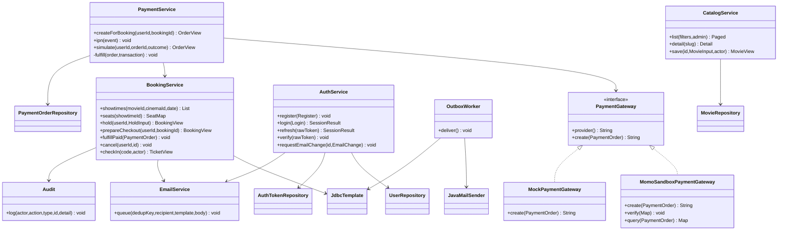

# Sơ đồ lớp Java

DTO là Java records trong AuthDtos/CatalogDtos/BookingDtos hoặc các record admin. Entity và repository JPA là lớp/interface riêng. Các quan hệ cinema/booking dùng FK và DTO thay vì serialize đồ thị entity; snapshot tránh thay đổi giá/tên ghế của vé đã mua.
