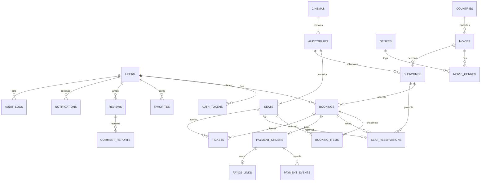

# Database ERD và từ điển dữ liệu

| Bảng | Trường trọng tâm | Ràng buộc / mục đích |
|---|---|---|
| users | email, password_hash, role, verified, locked, session_version | email unique; khóa/version cho quản trị/thu hồi phiên |
| auth_tokens | token_hash, kind, expires_at, consumed, target_email | hash unique; VERIFY/RESET/REFRESH/EMAIL_CHANGE |
| movies | slug, metadata, poster, backdrop, status, deleted | slug unique; soft delete; chỉ phim published được đặt |
| genres/countries | name, slug, active | slug unique; ngừng hoạt động thay xóa lịch sử |
| movie_genres | movie_id, genre_id | PK ghép/FK, nhiều-nhiều |
| cinemas | name, city, address, active | địa điểm demo, không phải đối tác thương mại |
| auditoriums | cinema_id, name, format | unique tên trong rạp |
| seats | auditorium_id, row_label, seat_number, kind, active | unique ghế trong phòng; STANDARD/VIP |
| showtimes | movie_id, auditorium_id, starts_at, ends_at, base_price | index ngày/phim/phòng; chống overlap tại service dưới room lock |
| bookings | id, user_id, showtime_id, status, total_amount, hold_until | index user/date và expiry; HOLD/PENDING/CONFIRMED/... |
| booking_items | booking_id, seat_id, seat_label, seat_kind, price | snapshot; unique booking/seat; không sửa giá cũ |
| seat_reservations | showtime_id, seat_id, booking_id, status | **unique suất/ghế**, HELD/BOOKED; hết hạn xóa reservation |
| payment_orders | amount, request_id, provider_transaction, purpose, booking_id | request/transaction unique; booking_id unique nullable cho tương thích |
| payment_events | order_id, kind, detail, created_at | dấu vết create/IPN/fulfillment/query |
| payos_links | order_code, order_id, payment_link_id, created_at | V5; code BIGINT PK trong giới hạn JS safe integer, order/link unique; FK payment_orders |
| tickets | booking_id, seat_id, code, status, used_at | code unique, booking/seat unique, soát một lần |
| favorites/reviews | user_id, movie_id | unique user/movie; stars check 1–5 |
| comment_reports | review_id, user_id, reason | mỗi user báo cáo một lần/đánh giá |
| email_outbox | dedup_key, status, attempts, next_attempt, last_error | dedup unique; trạng thái retry bền vững |
| notifications | user_id, type, content, read_at | index recipient/date; truy cập theo user hiện tại |
| audit_logs | actor_id, action, entity_type/id, detail | không chứa password/secret |
| banners/site_settings | phim nổi bật/thông tin công khai | admin cập nhật và ghi audit |

V1 còn các bảng seasons, episodes, watch_history, movie_views, subscription_plans và subscription_history từ thiết kế nền tảng ban đầu. Chúng không phải luồng sản phẩm bán vé hiện tại; V3 bảo toàn chúng để migration không phá dữ liệu cũ. Money dùng BIGINT VND, không dùng floating point. Thời gian là UTC; mọi quan hệ quan trọng có FK, không cascade xóa lịch sử thanh toán/vé.
