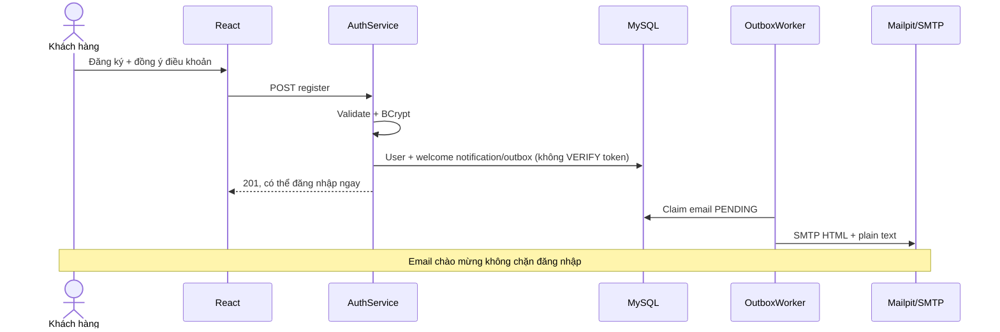
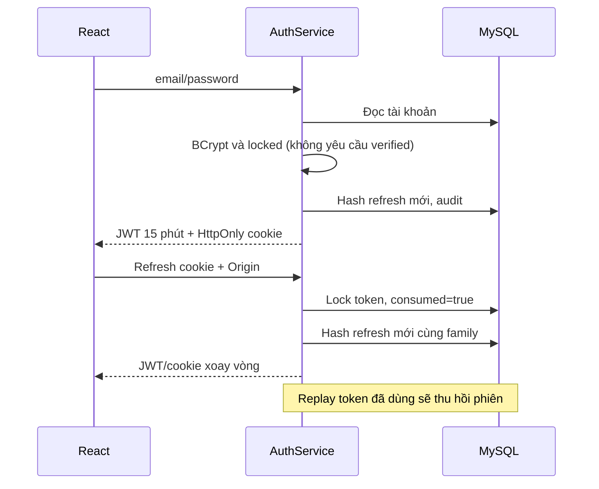
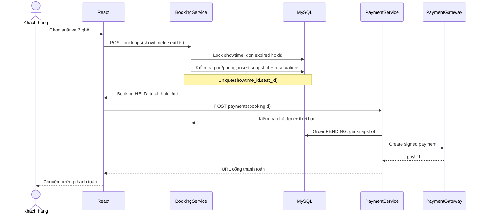
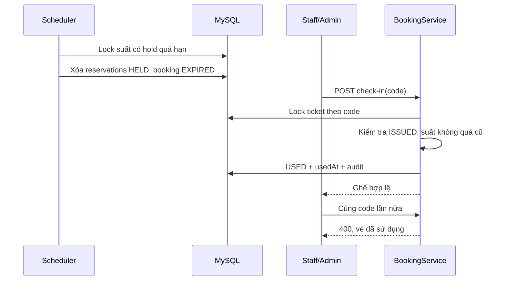

# Sequence diagrams

## Đăng ký và đăng nhập ngay



## Đăng nhập và refresh rotation



## Chọn suất, giữ ghế và thanh toán



## IPN MoMo và phát hành vé

```mermaid
sequenceDiagram
 participant M as MoMo Sandbox
 participant P as PaymentService
 participant B as BookingService
 participant D as MySQL
 participant W as OutboxWorker
 M->>P: IPN + HMAC
 P->>P: Verify signature/partner/request/amount/orderInfo
 P->>D: Lock payment order
 alt Đã PAID cùng transaction
  P-->>M: 204, không phát hành lại
 else Thanh toán resultCode=0
  P->>D: PAID + unique provider transaction
  P->>B: fulfillPaid
  B->>D: Lock showtime, kiểm tra reservations/thời hạn
  alt Ghế còn giữ hợp lệ
   B->>D: CONFIRMED + BOOKED + mỗi ghế 1 ticket + outbox
  else Giữ ghế đã hết hạn/hủy
   B->>D: PAYMENT_REVIEW + thông báo, không có vé
  end
  P-->>M: 204 sau commit
 end
 W->>D: Claim email
 W->>W: Gửi SMTP ngoài transaction nghiệp vụ
 Note over P,D: Redirect chỉ đọc trạng thái; không phát hành vé
```

## Hết hạn và soát vé


